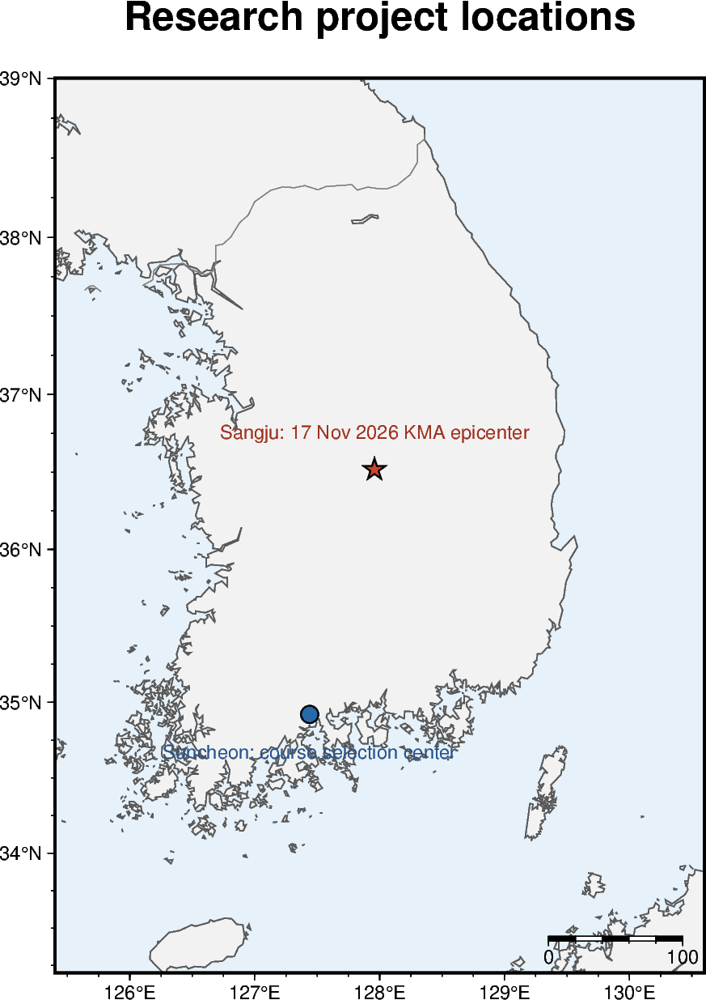

# Research projects: Suncheon and Sangju

Use your course methods to answer two related questions: what small earthquakes reveal about a fault beneath
Suncheon, and what the depths and timing of Sangju earthquakes reveal about activity in that region. Both projects
are required. Each has its own plan, criteria, data record, lab book and report, including validated template
matching. Your measurements determine the conclusions.

The circle marks the Suncheon course selection center; the star marks the epicenter reported by KMA for
17 November 2026. These markers orient the projects; the plans define the actual study selections. Sources:
the course's public [selection settings](https://github.com/seismoseo/SGTL-earthquake-source-tutorial/blob/main/data/manifests/sequences.yaml),
[KMA report](https://www.weather.go.kr/w/XML/INTENSITY/report_20261117231017.pdf), and
[GSHHG coastline](https://www.soest.hawaii.edu/pwessel/gshhg/) through GMT.

The project begins in [M60](notebooks/M60_full_run/M60_full_run.ipynb). A realistic starting schedule is weeks 9–16,
with the two projects developed in phases. You and your mentor may extend it or reduce the requested data volume;
keep both projects and their validation. Read each guide's context and questions before filling the templates.

| Project and starting observations | Files you own | Central questions |
|---|---|---|
| [Suncheon](suncheon_project.md): a published microearthquake cluster and a broader teaching-catalog selection | files in `project/`, including `ANALYSIS_PLAN.md`, `criteria.yaml`, `claims.csv`, `LABBOOK.md` and `REPORT.md` | Do apparent depth groups survive uncertainty tests, and what fault geometry do the locations and mechanisms support? |
| [Sangju](sangju_project.md): the public November 2026 earthquake report and a regional sample you will define | files under `project/sangju/` | How do earthquake depths compare with matched reference regions, and does activity continue outside short bursts once observing limits are accounted for? |

Write the numerical hypotheses, selection rules and rejection criteria before evaluating research results. This
is **preregistration**: it preserves what you planned before you knew the outcome. Record what you have already
seen in catalogs, course examples, papers and conversations. Start from documented source records and make your
own picks, locations and detections; trace every derived product to those inputs and your code. Separate published
claims from measurements you have checked. A later change is allowed through a dated amendment.

## Begin with the Suncheon plan

1. Finish M60's full analysis of the Gokseong sequence and its Suncheon data inventory.
2. Run `bin/sgtl new project` in your server terminal. M60 also offers the same copy step. It copies the templates
   once into `project/` and keeps any files you already have. Read `project/README.md` and `project/sangju/README.md`.
   Existing learners can run the same command after updating to add missing templates without replacing
   their Suncheon files.
3. Read Kwak et al. (2022), listed in the [reading list](reading_list.md). Write your own `claims.csv`: what the
   paper claims, where it says it, and how your measurements could test it. Mark any abstract-only claim and verify
   it against the full paper with your mentor before testing it.
4. Write `ANALYSIS_PLAN.md` and fill `criteria.yaml` before analyzing project results. Record everything you have
   already seen, including the M60 inventory, in the plan's prior-exposure section.
5. Have your mentor review and sign the plan. Freeze the criteria with the date and checksum described in M60,
   record it in `LABBOOK.md`, run your M60 project audit, and commit the files together.

Then write and obtain sign-off on the separate Sangju plan and data request as described in
[its guide](sangju_project.md). M60 checks the Suncheon files; keep the Sangju criteria in
`project/sangju/criteria.yaml` so each project's frozen decisions remain separate.

## Work from the two frozen plans

Inspect `bin/sgtl data fetch suncheon_area` before downloading. This is a project dataset of several gigabytes;
download it with `--apply --large` only after agreeing on the data plan. Then run
`bin/sgtl data verify suncheon_area`. Waveforms stay outside the repository in your course data folder.

Keep a daily lab-book entry with the notebook or command, settings, run-record fingerprint and result. Compare
alternative models and station selections according to the plan. Preserve a direct-P/S location baseline within
about 100 km; exclude the Moho phases Pn and Sn, and document how each production locator handles crustal first
arrivals. Change a frozen decision rule only with a dated plan amendment that records whether you had already seen
results bearing on it.

Template matching from [M22](notebooks/M22_detection/M22_detection.ipynb) is required in both projects. Complete the
Suncheon `TEMPLATE_MATCHING_PLAN.md` and the matching sections of the Sangju plan; keep the Suncheon plan's questions
and criteria structure for the M60 check. If its plan was already frozen, add a dated amendment before
viewing new detection outcomes. Freeze each
template bank, its channel/window rules, calibration records and validation records before measuring performance.
Evaluate records and earthquakes held out from template construction and tuning; inject known signals into
representative noise, run a noise-only null, and merge duplicate detections across templates before counting events.
Report the dependence on template choice, stations, time period and magnitude. A detector's missed events and gaps
must enter the uncertainty of a rate comparison.

## A phased schedule

| Target weeks | Work in both projects | Review point |
|---|---|---|
| 9–10 | complete inventories, define reference regions and usable observing time, freeze the two plans and data requests | mentor signs selection rules, criteria and validation partitions |
| 11–12 | make picks and locations from the source records; test depth uncertainty and station/model/phase sensitivity | compare synthetic recovery and direct-P/S baselines before interpreting depth |
| 13–14 | relocate, examine geometry and resolvable mechanisms; run template matching on the frozen windows | assess detections on held-out and injection tests, then compare completeness and rates |
| 15–16 | finish the reference-region and sensitivity comparisons, reproduce the analysis and write both reports | evidence checklist, joint talk and oral defense |

Move a review point when the data or pace require it. Do not trade away validation to finish a larger catalog.

## Finish with two reports and one comparison

- Complete `project/REPORT.md`, including its Korean and English summaries. Give uncertainties and name the
  notebook or script that prints each reported number.
- Complete `project/sangju/REPORT.md`, including data provenance, matched reference regions, depth tests,
  observing-time/completeness analysis and template-matching validation. Add its comparison with Suncheon.
- Adapt `project/TALK_OUTLINE.md` into one joint 15-minute talk covering both projects and their different limits.
  Prepare to explain your code and reasoning at the oral defense.
- Review both plans, amendments, inventories, lab books, run records and reports with your mentor. Completion
  includes the M60 Suncheon audit and the Sangju evidence review in its README. An unresolved mechanism, an
  unsupported hypothesis or an inconclusive comparison is a valid result when you can explain the evidence.

Use the [Git workflow](git_workflow.md) to save your work and the [data policy](data_policy.md) for sharing and
attribution. The [curriculum](curriculum.md) gives the project schedule.
