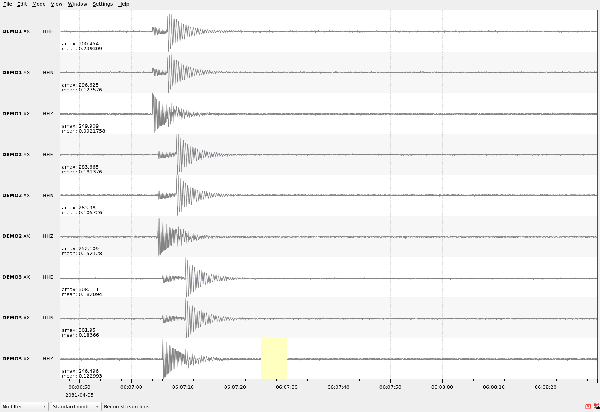
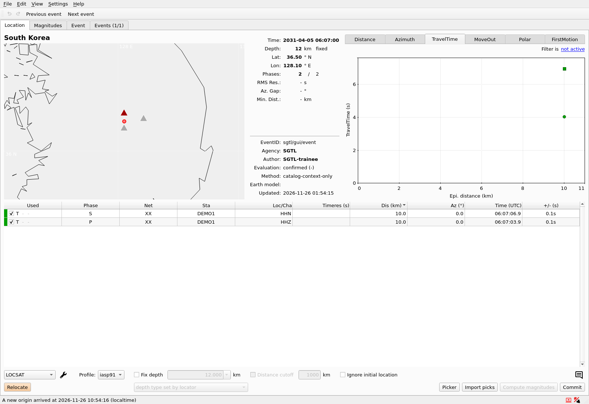
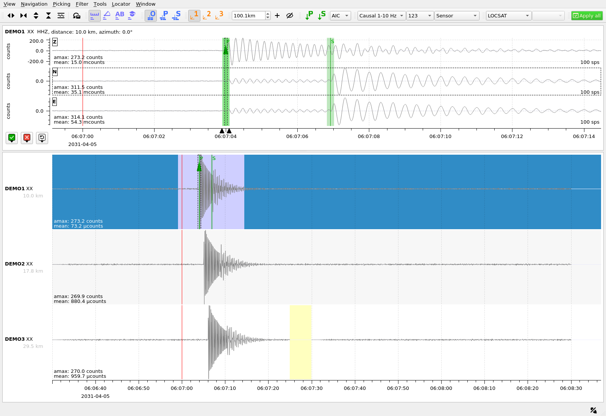

# Explore earthquakes with SeisComP

Use this workshop after your first M03 download, alongside M10, and again for the manual picks of M20. The first visit
takes 60-90 minutes. **SeisComP** is earthquake-monitoring software. Here its desktop windows (its **GUI**) run
**offline** on your own files: `scrttv` shows waveforms, and `scolv` shows the event and is the picker. No desktop
window? Use the notebook picker E2. You need not learn the SAC program. Click a screenshot to enlarge it.

## 1. Install and check (once)

On the **server**:

```bash
cd ~/sgtl/tutorial
bin/sgtl-install seiscomp
bin/sgtl-install seiscomp --apply
bin/sgtl gui doctor
```

The first command prints the plan; the second installs **SeisComP 7.4.0** (tested on **Rocky/RHEL 8, Linux x86_64**)
into `~/sgtl/seiscomp/`. A missing `DISPLAY` warning is expected now. On another operating system, your mentor
supplies a **GUI-enabled** installation; point to it in each terminal:

```bash
export SGTL_SEISCOMP_ROOT=/path/provided/by/your/mentor/seiscomp
bin/sgtl gui doctor
```

Never copy a binary built for another system, or install packages into the SGTL kernel to repair Qt. For the mentor:
[binary downloads](https://www.seiscomp.de/downloader/), [source installation](https://docs.gempa.de/seiscomp/current/base/build.html)
(a source build needs `SC_GLOBAL_GUI=ON`).

## 2. Show a server window on your laptop

The Jupyter tunnel carries only notebook pages; a desktop window needs **X11 forwarding** through SSH.

1. Start an X server on your **laptop**: [MobaXterm](https://mobaxterm.mobatek.net/documentation.html) on Windows (use
   its local terminal), [XQuartz](https://www.xquartz.org/) on macOS (log out and in once after installing). Linux
   desktops usually have one.
2. From that laptop terminal:

   ```bash
   ssh -Y <your_id>@<server>
   ```

3. In that new server terminal:

   ```bash
   cd ~/sgtl/tutorial
   export PATH="${SGTL_HOME:-$HOME/sgtl}/envs/sgtl/bin:$PATH"
   echo "$DISPLAY"
   bin/sgtl gui doctor
   ```

`DISPLAY` should show a value such as `localhost:10.0`. Keep this terminal open; a JupyterLab terminal has no display.
If `DISPLAY` is empty, never type a value: reconnect from the laptop X server, or ask your mentor.

## 3. Rehearse with synthetic records

Start here even with real data. Three invented stations record **made-up signals** dated 5 April 2031; one vertical
channel has a five-second gap.

```bash
bin/sgtl gui demo
bin/sgtl gui demo --apply
bin/sgtl gui open work/seiscomp/demo
bin/sgtl gui open work/seiscomp/demo --apply
```

Without `--apply` a command only prints its plan. For another rehearsal, choose a new `--out`, such as
`work/seiscomp/demo2`: preparation refuses an existing session folder.

[](figures/seiscomp_waveforms.png)

*`scrttv` in the rehearsal. The blank interval is missing data, not a quiet instrument.*

1. Read a stream ID: `XX.DEMO1..HHZ` is network `XX`, station `DEMO1`, an empty location code and the vertical
   channel `HHZ` (N and E are north and east).
2. Find the gap in `XX.DEMO3..HHZ` (**B** shows record borders). A gap has no samples; a flat trace has samples.
3. Zoom by right-dragging along the time axis; **Ctrl+N** resets.
4. Press **F** for the causal 1-10 Hz filter, which can delay an onset. Judge polarity on the raw trace.

**Watch out:** `scrttv` shows **original counts** (`--no-inventory`): no gain, no response removed. Counts cannot be
compared between instruments.

## 4. Look at the event and the stations

```bash
bin/sgtl gui open work/seiscomp/demo --app event
bin/sgtl gui open work/seiscomp/demo --app event --apply
```

[](figures/seiscomp_event.png)

*The map, the origin and the arrival table. The coastline is context, not a mapped fault.*

1. Find the origin time, position and depth. An **origin** is one estimate of where and when an earthquake started.
2. Click **Picker** (lower right), then a station row to enlarge its three components.
3. Where are there no stations? The largest empty angle is the **azimuthal gap**. A close station does not guarantee
   a good depth, which trades off with origin time and wave speed (M30, M31).

## 5. Pick P and S, and save them

A **pick** is your measured arrival time; its **uncertainty** is the range of onset times you would still accept.

[](figures/seiscomp_picker.png)

*The selected station, enlarged. Read P on Z; compare N and E for S.*

1. Select a station. Leave **View → Show trace values in sensor units** off: labels say **counts**. Keep Z/N/E; do
   not rotate to R/T. Zoom with **Ctrl+Right**/**Ctrl+Left** or a right-drag; **W** resets.
2. **F1** (pick P), click the Z onset, **Space** (set pick). Pick the last noise sample before the signal, not the
   peak. **Esc** leaves picking mode.
3. Right-click the marker → **Uncertainty** (**Define…** for an asymmetric interval). Every pick needs one. M20
   accepts 0.005-0.5 s for P and 0.01-1.0 s for S; at 100 samples/s one sample is 0.01 s.
4. Same menu: **Polarity → positive**, **negative** or **undecidable** (U, D or `?` in the CSV), judged in **raw
   counts**. Never force a sign to fit a mechanism.
5. **F2** (pick S) on the original HHN or HHE channel with the clearer onset. Click where amplitude and oscillation
   change in the P coda, press **Space** and set the uncertainty. S follows P.
6. M20 needs at least six stations within 100 km with P and S, and at least three clear P polarities.
7. **Apply all (F5)** in the picker, **Commit** in the **Location** window, then **File → Save** as `reviewed.xml` in
   the session folder (keep `event.xml`). Reopen it with **File → Open** to check.

**Watch out:** only Save writes the file; close without saving and the picks are lost. Leave **Relocate** and the
magnitude buttons alone: SeisComP may predict with a global model such as iasp91, so never move a pick onto a
predicted line. To resume, open your `reviewed.xml` and the reviewed origin from **Events**; the catalog origin may
show zero arrivals.

## 6. Pick your Sangju teaching records

After M03 has fetched `sangju2019` and installed the station metadata:

```bash
bin/sgtl data verify sangju2019
bin/sgtl gui prepare sangju2019 --out work/seiscomp/sangju2019
bin/sgtl gui prepare sangju2019 --out work/seiscomp/sangju2019 --apply
bin/sgtl gui open work/seiscomp/sangju2019 --app event --apply
```

The event is the teaching earthquake of **21 July 2019, 02:04:18 UTC (11:04:18 KST), ML 3.9**, not the 2026 Sangju
project. The session uses the original HH records within 100 km and keeps gaps and counts. It checks each metadata
**epoch**, the time span in which a metadata entry is valid. Repeat step 5, save
`work/seiscomp/sangju2019/reviewed.xml`, and from the tutorial folder run:

```bash
bin/sgtl gui import-picks work/seiscomp/sangju2019 \
  --xml work/seiscomp/sangju2019/reviewed.xml \
  --out work/picks/M20_manual_picks.csv
```

This dry run checks your export; if it lists several origins, add `--origin-id 'the ID printed above'` for your
reviewed revision. Repeat with **`--apply`** to write the CSV and its `.seiscomp.json` receipt; keep the XML beside
them. The CSV has the columns `station,phase,channel,time_utc,uncertainty_s,polarity`; an asymmetric uncertainty
becomes its larger half-width. The importer never overwrites a CSV: export a revision to a new file. In M20 keep
`PICKS_CSV = "../picks/M20_manual_picks.csv"`, skip saving from E2, and run the **unchanged M20-T5 check**. M21,
M22, M30, M31, M50 and M53 reuse the CSV.

## 7. In the research projects

After your plan freezes the area, window and data, prepare each research event with its context:

```bash
bin/sgtl gui prepare --waveforms /path/to/your/event/HH \
  --stationxml /path/to/your/stationxml \
  --origin 2031-04-05T06:07:00Z --latitude 36.5 --longitude 128.1 --depth-km 12 \
  --out work/seiscomp/project-event
```

**Every value above is an invented example:** use your event and cite its catalog. `--depth-km` only places the event
on the map; it is not a measured depth. Repeat with `--apply` after reading the plan. A template-matching candidate
and its template need the same components, filter and time scale; a high correlation alone proves no earthquake.

**Data policy:** waveforms, GUI session exports and real-data screenshots stay private. Git ignores `work/seiscomp/`
(sessions hold waveform copies); commit the reviewed CSV and receipt under `work/picks/`. This page shows synthetic
signals only.

## When something goes wrong

| What you see | What to do |
|---|---|
| `No DISPLAY` / cannot open display | use the terminal from your laptop X server; reconnect with `ssh -Y`; never set `DISPLAY` by hand |
| Qt plugin or shared-library error | run `bin/sgtl gui doctor` and show your mentor; keep the GUI apart from conda's Qt |
| `scolv` or `scrttv` missing | the installation is headless: use a GUI-enabled build and the right `SGTL_SEISCOMP_ROOT` |
| empty trace view | check the UTC date, stream IDs and station epoch; select a station row; a blank interval can be a gap |
| no saved picks / zero arrivals | Space → Apply all → Commit → File → Save; reopen the saved XML |
| "several origins" during import | read the printed IDs and arrival counts; choose your reviewed revision |
| output already exists | export to a new session or CSV |
| polarity differs from the notebook | compare unfiltered counts, the same Z channel and the same metadata epoch (M20) |

Manuals: [`scrttv`](https://docs.gempa.de/seiscomp/current/apps/scrttv.html),
[`scolv`](https://docs.gempa.de/seiscomp/current/apps/scolv.html),
[`fdsnxml2inv`](https://docs.gempa.de/seiscomp/current/apps/fdsnxml2inv.html) (StationXML to SeisComP inventory).
